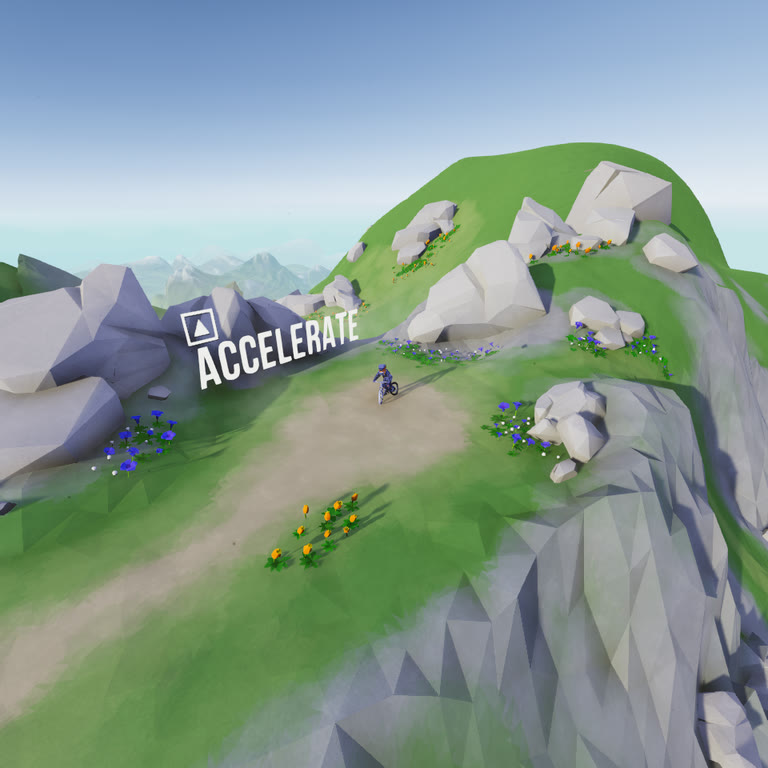
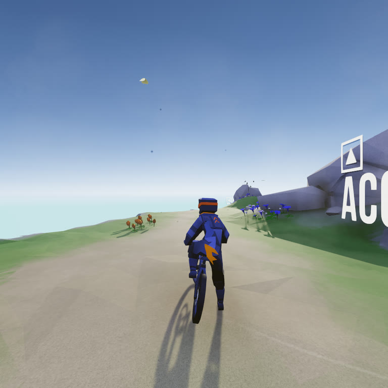
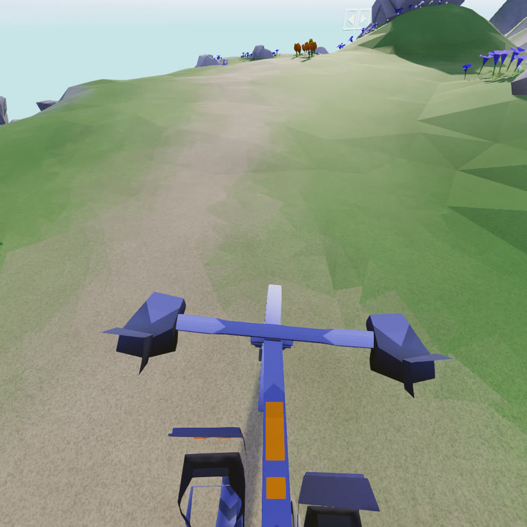
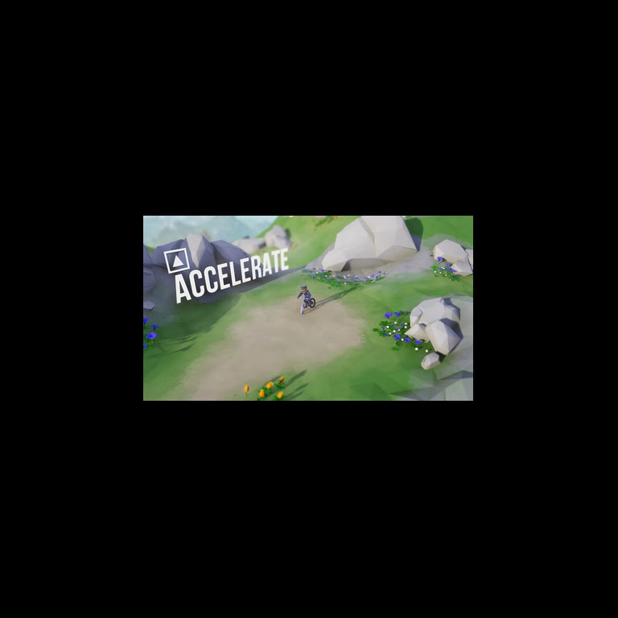

# LMD VR

Lonely Mountains: Downhill in VR. A [MelonLoader](https://github.com/LavaGang/MelonLoader) mod that talks to the
headset through OpenXR.

You need a PC VR headset (tested with a Quest 2). A gamepad is easiest with the headset on, but every shortcut also has a key.

## Install

1. Open the game folder (Steam: right-click the game → Manage → Browse local files).
2. Download `MelonLoader.x64.zip` (0.7) from the [MelonLoader releases](https://github.com/LavaGang/MelonLoader/releases)
   and extract it into the game folder. Use the zip, not the installer: the installer can pick the wrong build for
   this game. Start the game once, then quit.
3. Extract the LMD VR zip from the releases page into the game folder.
4. Connect your headset. Its PC app (Meta Horizon Link, SteamVR, Virtual Desktop, …) must be the active OpenXR
   runtime; there is a setting for it in the app.
5. Start the game. VR starts by itself.

## Cameras

<table>
<tr><th width="50%">Diorama</th><th width="50%">Third person</th></tr>
<tr>
<td></td>
<td></td>
</tr>
<tr><th>First person</th><th>Screen</th></tr>
<tr>
<td></td>
<td></td>
</tr>
</table>

## Controls

| Gamepad | Keyboard | |
|---|---|---|
| LB + RB + D-pad ← → | F5 / Shift+F5 | Switch camera |
| LB + RB + D-pad ↑ ↓ | + / − | **Diorama:** zoom **Third person:** distance **First person:** field of view **Screen:** 3D depth |
| Right stick | Numpad 4 6 8 2 (NumLock on) | **Third person:** move around the bike **First person:** look around **Screen:** size |
| R3 | Numpad 5 | Undo the right stick |
| L3 + R3 | F10 | Re-center the view |
| | F9 | VR on / off |

The game itself doesn't use these buttons while riding. When a ride starts, the view centers on where you look.

## Settings

Everything you change in game is saved to `UserData\LMDVR.cfg`, where each setting is explained. Edit it with the
game closed, or while playing and press F11 (resolution, vignette and window settings need a restart).
Third person is called `Chase` in that file.

A wider field of view in first person shows more of the trail, but the world swims a little when you turn your
head. The default is the headset's own.

## Notes

- Works next to the Alternative Camera mod, which is paused while the headset is on.
- Low frame rate: lower `ResolutionScale` in the settings.
- Problems: the log is `MelonLoader\Latest.log`, this mod's lines start with `[LMD_VR]`.

## Building

You need the game with MelonLoader (started once), a .NET SDK 6 or newer, and the Khronos OpenXR loader: download
`OpenXR.Loader.1.1.63.nupkg` from the [OpenXR SDK release](https://github.com/KhronosGroup/OpenXR-SDK-Source/releases/tag/release-1.1.63)
and extract it into `.tools\openxr` (it's a zip file).
`.\build.ps1` builds and copies the mod into the game; `-Package` makes the release zip, `-GameDir` points to
another install. Without a headset, F6 shows the left eye on the monitor and F7 saves both eye images.

## Credits

- **DevdudeX** for the [Alternative Camera mod](https://github.com/DevdudeX/LMD-Alternative-Camera-Mod). Its code
  showed how the game's cameras work, and first person uses its camera settings.
- **faehrmaniac** for the [Photo Mode fork](https://github.com/faehrmaniac/LMD-Alternative-Camera-Mod), the source
  this mod was learned from.
- **Megagon Industries** for the game.

## License

MIT, see [LICENSE](LICENSE). The included OpenXR loader is from the Khronos Group, see
[THIRD-PARTY-NOTICES.md](THIRD-PARTY-NOTICES.md). Not affiliated with Megagon Industries.
